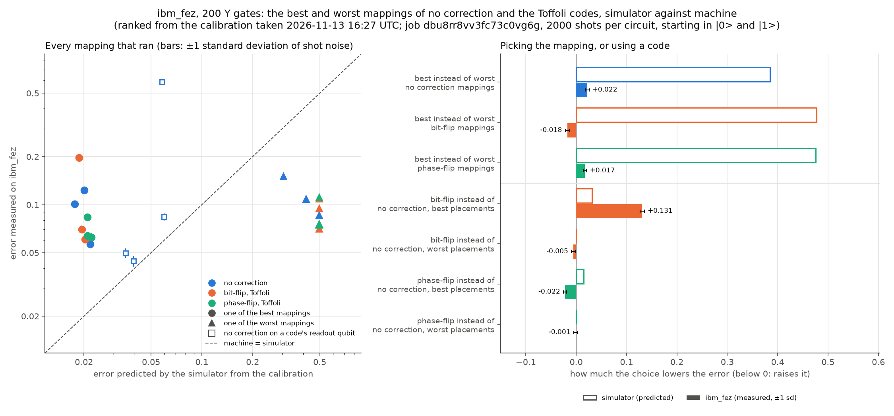

# Best and worst mappings on the real ibm_fez: 200 Y gates

Job `dbu8rr8vv3fc73c0vg6g`, submitted 2026-11-17T17:25:01+00:00 (UTC): 44 circuits of 2000 shots each, every mapping starting once in each of |0> and |1>. The mappings are ranked by the error the noise simulator predicts for them from the calibration file `ibm_fez_calibrations_2026-11-13T16_27_59Z.csv` (taken 2026-11-13 16:27 UTC): mapping_sweep.py's simulator and circuits, with the calibration's noise numbers instead of FakeFez's. The machine ran the top 3 of each option's best and worst lists, and no correction on the Fez qubit each of those code placements is read out on (the head-to-head runs).

An error is the chance of reading the wrong answer, averaged over |0> and |1>. The machine's errors have shot noise of about ±0.004 (one standard deviation), so smaller differences aren't clear.

Left out of the ranking (numbers missing from the calibration file, or not offered by the machine): Fez 72, 148, 149.

## In short

- **Do the mappings matter as much on ibm_fez as on the simulator? Much less.** Going from the worst to the best mappings lowered the error by 0.019 on the machine (averaged over the three options), against 0.446 on the simulator: 4% as much.
- The simulator put the 22 mappings that ran in a different order as the machine did (rank correlation 0.14, where 1 is the same order and 0 unrelated).
- **Picking good qubits or using a code?** On the machine, the code mattered more: picking the mapping changed the error by 0.019 on average, and using a code (against no correction on the same qubits) by 0.040, so the code mattered 2.1 times as much. On the simulator: 0.446 and 0.012 (the mapping 37.9 times as much).
- Good qubits with no correction against bad qubits with a code: no correction had the lower error in 8 of 18 pairs on the machine, and in 18 of 18 on the simulator.

## The 10 best mappings of each option, as predicted

"(ran)" marks the top 3, which ran on the machine.

| rank | no correction | predicted | bit-flip              | predicted | phase-flip            | predicted |
|-----:|---------------|----------:|-----------------------|----------:|-----------------------|----------:|
|    1 | Fez 9 (ran)   |    0.0177 | (115, 99, 114) (ran)  |    0.0187 | (3, 4, 2) (ran)       |    0.0210 |
|    2 | Fez 46 (ran)  |    0.0201 | (145, 146, 144) (ran) |    0.0194 | (131, 130, 132) (ran) |    0.0210 |
|    3 | Fez 85 (ran)  |    0.0218 | (3, 4, 2) (ran)       |    0.0203 | (3, 16, 2) (ran)      |    0.0222 |
|    4 | Fez 109       |    0.0223 | (98, 91, 111)         |    0.0206 | (3, 2, 4)             |    0.0227 |
|    5 | Fez 146       |    0.0226 | (131, 130, 132)       |    0.0207 | (115, 99, 114)        |    0.0230 |
|    6 | Fez 42        |    0.0291 | (9, 10, 8)            |    0.0210 | (141, 140, 142)       |    0.0234 |
|    7 | Fez 150       |    0.0291 | (122, 123, 121)       |    0.0212 | (132, 130, 131)       |    0.0236 |
|    8 | Fez 91        |    0.0296 | (123, 124, 122)       |    0.0212 | (136, 123, 143)       |    0.0241 |
|    9 | Fez 122       |    0.0312 | (3, 16, 2)            |    0.0214 | (16, 3, 23)           |    0.0241 |
|   10 | Fez 98        |    0.0332 | (125, 117, 124)       |    0.0215 | (22, 21, 23)          |    0.0242 |

## The 10 worst mappings of each option, as predicted

"(ran)" marks the top 3, which ran on the machine.

| rank | no correction | predicted | bit-flip              | predicted | phase-flip            | predicted |
|-----:|---------------|----------:|-----------------------|----------:|-----------------------|----------:|
|    1 | Fez 155 (ran) |    0.4967 | (135, 139, 155) (ran) |    0.4968 | (135, 139, 155) (ran) |    0.4969 |
|    2 | Fez 27 (ran)  |    0.4137 | (155, 135, 139) (ran) |    0.4968 | (155, 135, 139) (ran) |    0.4969 |
|    3 | Fez 102 (ran) |    0.3036 | (153, 154, 155) (ran) |    0.4968 | (153, 154, 155) (ran) |    0.4969 |
|    4 | Fez 11        |    0.2635 | (155, 153, 154)       |    0.4967 | (155, 153, 154)       |    0.4969 |
|    5 | Fez 100       |    0.2499 | (139, 135, 155)       |    0.4967 | (139, 135, 155)       |    0.4968 |
|    6 | Fez 0         |    0.2337 | (154, 153, 155)       |    0.4967 | (154, 153, 155)       |    0.4968 |
|    7 | Fez 70        |    0.2037 | (28, 26, 27)          |    0.4326 | (28, 26, 27)          |    0.4330 |
|    8 | Fez 126       |    0.1949 | (28, 17, 27)          |    0.4310 | (28, 17, 27)          |    0.4312 |
|    9 | Fez 19        |    0.1763 | (27, 29, 28)          |    0.4142 | (27, 29, 28)          |    0.4164 |
|   10 | Fez 24        |    0.1757 | (28, 27, 26)          |    0.4110 | (28, 27, 26)          |    0.4120 |

## What the machine measured

Every mapping that ran, with the Fez qubits its circuits used (routing can add one, through a SWAP) and the one its result was read out on.

| option        | why it ran                                                                                                                                                                                                                                                    | mapping         | ran on Fez qubits | read out on | simulator |         machine | machine, starting in 0 / 1 |
|---------------|---------------------------------------------------------------------------------------------------------------------------------------------------------------------------------------------------------------------------------------------------------------|-----------------|-------------------|------------:|----------:|----------------:|---------------------------:|
| no correction | best 1                                                                                                                                                                                                                                                        | Fez 9           | 9                 |           9 |    0.0177 | 0.1010 ± 0.0048 |            0.1010 / 0.1010 |
| no correction | best 2                                                                                                                                                                                                                                                        | Fez 46          | 46                |          46 |    0.0201 | 0.1230 ± 0.0052 |            0.1100 / 0.1360 |
| no correction | best 3                                                                                                                                                                                                                                                        | Fez 85          | 85                |          85 |    0.0218 | 0.0568 ± 0.0037 |            0.0595 / 0.0540 |
| no correction | worst 1; same qubit as bit-flip (135, 139, 155); same qubit as bit-flip (155, 135, 139); same qubit as bit-flip (153, 154, 155); same qubit as phase-flip (135, 139, 155); same qubit as phase-flip (155, 135, 139); same qubit as phase-flip (153, 154, 155) | Fez 155         | 155               |         155 |    0.4967 | 0.0863 ± 0.0044 |            0.0920 / 0.0805 |
| no correction | worst 2                                                                                                                                                                                                                                                       | Fez 27          | 27                |          27 |    0.4137 | 0.1088 ± 0.0049 |            0.1200 / 0.0975 |
| no correction | worst 3                                                                                                                                                                                                                                                       | Fez 102         | 102               |         102 |    0.3036 | 0.1507 ± 0.0056 |            0.1160 / 0.1855 |
| bit-flip      | best 1                                                                                                                                                                                                                                                        | (115, 99, 114)  | 99, 114, 115      |         114 |    0.0187 | 0.1975 ± 0.0062 |            0.1395 / 0.2555 |
| bit-flip      | best 2                                                                                                                                                                                                                                                        | (145, 146, 144) | 144, 145, 146     |         144 |    0.0194 | 0.0700 ± 0.0040 |            0.0545 / 0.0855 |
| bit-flip      | best 3                                                                                                                                                                                                                                                        | (3, 4, 2)       | 2, 3, 4           |           2 |    0.0203 | 0.0608 ± 0.0038 |            0.0480 / 0.0735 |
| bit-flip      | worst 1                                                                                                                                                                                                                                                       | (135, 139, 155) | 135, 139, 155     |         155 |    0.4968 | 0.1095 ± 0.0049 |            0.0750 / 0.1440 |
| bit-flip      | worst 2                                                                                                                                                                                                                                                       | (155, 135, 139) | 135, 139, 155     |         155 |    0.4968 | 0.0948 ± 0.0046 |            0.0665 / 0.1230 |
| bit-flip      | worst 3                                                                                                                                                                                                                                                       | (153, 154, 155) | 153, 154, 155     |         155 |    0.4968 | 0.0710 ± 0.0040 |            0.0485 / 0.0935 |
| phase-flip    | best 1                                                                                                                                                                                                                                                        | (3, 4, 2)       | 2, 3, 4           |           2 |    0.0210 | 0.0638 ± 0.0039 |            0.0540 / 0.0735 |
| phase-flip    | best 2                                                                                                                                                                                                                                                        | (131, 130, 132) | 130, 131, 132     |         132 |    0.0210 | 0.0835 ± 0.0044 |            0.0795 / 0.0875 |
| phase-flip    | best 3                                                                                                                                                                                                                                                        | (3, 16, 2)      | 2, 3, 16          |           2 |    0.0222 | 0.0625 ± 0.0038 |            0.0525 / 0.0725 |
| phase-flip    | worst 1                                                                                                                                                                                                                                                       | (135, 139, 155) | 135, 139, 155     |         155 |    0.4969 | 0.1110 ± 0.0049 |            0.0765 / 0.1455 |
| phase-flip    | worst 2                                                                                                                                                                                                                                                       | (155, 135, 139) | 135, 139, 155     |         155 |    0.4969 | 0.0758 ± 0.0042 |            0.0470 / 0.1045 |
| phase-flip    | worst 3                                                                                                                                                                                                                                                       | (153, 154, 155) | 153, 154, 155     |         155 |    0.4969 | 0.0750 ± 0.0041 |            0.0510 / 0.0990 |
| no correction | same qubit as bit-flip (3, 4, 2); same qubit as phase-flip (3, 4, 2); same qubit as phase-flip (3, 16, 2)                                                                                                                                                     | Fez 2           | 2                 |           2 |    0.0352 | 0.0498 ± 0.0034 |            0.0435 / 0.0560 |
| no correction | same qubit as bit-flip (115, 99, 114)                                                                                                                                                                                                                         | Fez 114         | 114               |         114 |    0.0581 | 0.5882 ± 0.0078 |            0.6040 / 0.5725 |
| no correction | same qubit as phase-flip (131, 130, 132)                                                                                                                                                                                                                      | Fez 132         | 132               |         132 |    0.0393 | 0.0442 ± 0.0033 |            0.0410 / 0.0475 |
| no correction | same qubit as bit-flip (145, 146, 144)                                                                                                                                                                                                                        | Fez 144         | 144               |         144 |    0.0598 | 0.0840 ± 0.0044 |            0.0810 / 0.0870 |

## Do the mappings matter as much on the machine?

Each option's top 3 best and worst mappings, averaged, and the gap between them: how much picking the best mappings instead of the worst lowers the error.

| option        | best: simulator | best: machine | worst: simulator | worst: machine | gap: simulator |     gap: machine | machine / simulator |
|---------------|----------------:|--------------:|-----------------:|---------------:|---------------:|-----------------:|--------------------:|
| no correction |          0.0198 |        0.0936 |           0.4047 |         0.1153 |         0.3848 |  0.0217 ± 0.0039 |                  6% |
| bit-flip      |          0.0195 |        0.1094 |           0.4968 |         0.0917 |         0.4773 | -0.0177 ± 0.0038 |                 -4% |
| phase-flip    |          0.0214 |        0.0699 |           0.4969 |         0.0872 |         0.4755 |  0.0173 ± 0.0035 |                  4% |

- Rank correlation between the simulator's errors and the machine's, over all 22 mappings that ran: 0.14 (1 = the same order, 0 = unrelated). By option: no correction 0.18, bit-flip 0.09, phase-flip 0.54

## Picking good qubits or using a code?

How much each choice lowers the error (below 0: raises it). Picking the mapping is each option's gap from the table above, with the option held fixed. Using a code compares each code's best and worst placements with no correction on the very Fez qubit each of its placements is read out on (the head-to-head runs below), so only the code changes.

| choice                                                | simulator |          machine |
|-------------------------------------------------------|----------:|-----------------:|
| best instead of worst mappings, no correction         |   +0.3848 | +0.0217 ± 0.0039 |
| best instead of worst mappings, bit-flip              |   +0.4773 | -0.0177 ± 0.0038 |
| best instead of worst mappings, phase-flip            |   +0.4755 | +0.0173 ± 0.0035 |
| bit-flip instead of no correction, best placements    |   +0.0316 | +0.1313 ± 0.0042 |
| bit-flip instead of no correction, worst placements   |   -0.0001 | -0.0055 ± 0.0037 |
| phase-flip instead of no correction, best placements  |   +0.0152 | -0.0220 ± 0.0030 |
| phase-flip instead of no correction, worst placements |   -0.0002 | -0.0010 ± 0.0036 |

### The match-ups

As in mapping_pay_off.py, each match-up pairs every one of the 3 code placements with every one of the 3 no-correction qubits, here at 200 gates. Each cell says which had the lower error on the machine and by how much ("too close" when the gap is under two standard deviations of shot noise), then which the simulator predicted. The headers give each mapping's error on the machine, with the simulator's in brackets.

#### Worst no correction vs best codes

| code       | best placements                    | vs Fez 155: 0.086 (sim 0.497) |  vs Fez 27: 0.109 (sim 0.414) | vs Fez 102: 0.151 (sim 0.304) |
|------------|------------------------------------|------------------------------:|------------------------------:|------------------------------:|
| bit-flip   | (115, 99, 114): 0.197 (sim 0.019)  | none, 0.111 lower (sim: code) | none, 0.089 lower (sim: code) | none, 0.047 lower (sim: code) |
| bit-flip   | (145, 146, 144): 0.070 (sim 0.019) | code, 0.016 lower (sim: code) | code, 0.039 lower (sim: code) | code, 0.081 lower (sim: code) |
| bit-flip   | (3, 4, 2): 0.061 (sim 0.020)       | code, 0.026 lower (sim: code) | code, 0.048 lower (sim: code) | code, 0.090 lower (sim: code) |
| phase-flip | (3, 4, 2): 0.064 (sim 0.021)       | code, 0.023 lower (sim: code) | code, 0.045 lower (sim: code) | code, 0.087 lower (sim: code) |
| phase-flip | (131, 130, 132): 0.084 (sim 0.021) | too close, +0.003 (sim: code) | code, 0.025 lower (sim: code) | code, 0.067 lower (sim: code) |
| phase-flip | (3, 16, 2): 0.062 (sim 0.022)      | code, 0.024 lower (sim: code) | code, 0.046 lower (sim: code) | code, 0.088 lower (sim: code) |

- bit-flip: lower than no correction in 6 of 9 pairs on the machine (6 by more than two standard deviations), and in 9 of 9 on the simulator
- phase-flip: lower than no correction in 9 of 9 pairs on the machine (8 by more than two standard deviations), and in 9 of 9 on the simulator

#### Best no correction vs worst codes

| code       | worst placements                   |   vs Fez 9: 0.101 (sim 0.018) |  vs Fez 46: 0.123 (sim 0.020) |  vs Fez 85: 0.057 (sim 0.022) |
|------------|------------------------------------|------------------------------:|------------------------------:|------------------------------:|
| bit-flip   | (135, 139, 155): 0.110 (sim 0.497) | too close, -0.009 (sim: none) | too close, +0.013 (sim: none) | none, 0.053 lower (sim: none) |
| bit-flip   | (155, 135, 139): 0.095 (sim 0.497) | too close, +0.006 (sim: none) | code, 0.028 lower (sim: none) | none, 0.038 lower (sim: none) |
| bit-flip   | (153, 154, 155): 0.071 (sim 0.497) | code, 0.030 lower (sim: none) | code, 0.052 lower (sim: none) | none, 0.014 lower (sim: none) |
| phase-flip | (135, 139, 155): 0.111 (sim 0.497) | too close, -0.010 (sim: none) | too close, +0.012 (sim: none) | none, 0.054 lower (sim: none) |
| phase-flip | (155, 135, 139): 0.076 (sim 0.497) | code, 0.025 lower (sim: none) | code, 0.047 lower (sim: none) | none, 0.019 lower (sim: none) |
| phase-flip | (153, 154, 155): 0.075 (sim 0.497) | code, 0.026 lower (sim: none) | code, 0.048 lower (sim: none) | none, 0.018 lower (sim: none) |

- bit-flip: lower than no correction in 5 of 9 pairs on the machine (3 by more than two standard deviations), and in 0 of 9 on the simulator
- phase-flip: lower than no correction in 5 of 9 pairs on the machine (4 by more than two standard deviations), and in 0 of 9 on the simulator

#### Best no correction vs best codes

| code       | best placements                    |   vs Fez 9: 0.101 (sim 0.018) |  vs Fez 46: 0.123 (sim 0.020) |  vs Fez 85: 0.057 (sim 0.022) |
|------------|------------------------------------|------------------------------:|------------------------------:|------------------------------:|
| bit-flip   | (115, 99, 114): 0.197 (sim 0.019)  | none, 0.096 lower (sim: none) | none, 0.074 lower (sim: code) | none, 0.141 lower (sim: code) |
| bit-flip   | (145, 146, 144): 0.070 (sim 0.019) | code, 0.031 lower (sim: none) | code, 0.053 lower (sim: code) | none, 0.013 lower (sim: code) |
| bit-flip   | (3, 4, 2): 0.061 (sim 0.020)       | code, 0.040 lower (sim: none) | code, 0.062 lower (sim: none) | too close, -0.004 (sim: code) |
| phase-flip | (3, 4, 2): 0.064 (sim 0.021)       | code, 0.037 lower (sim: none) | code, 0.059 lower (sim: none) | too close, -0.007 (sim: code) |
| phase-flip | (131, 130, 132): 0.084 (sim 0.021) | code, 0.017 lower (sim: none) | code, 0.039 lower (sim: none) | none, 0.027 lower (sim: code) |
| phase-flip | (3, 16, 2): 0.062 (sim 0.022)      | code, 0.038 lower (sim: none) | code, 0.060 lower (sim: none) | too close, -0.006 (sim: none) |

- bit-flip: lower than no correction in 4 of 9 pairs on the machine (4 by more than two standard deviations), and in 5 of 9 on the simulator
- phase-flip: lower than no correction in 6 of 9 pairs on the machine (6 by more than two standard deviations), and in 2 of 9 on the simulator

#### Worst no correction vs worst codes

| code       | worst placements                   | vs Fez 155: 0.086 (sim 0.497) |  vs Fez 27: 0.109 (sim 0.414) | vs Fez 102: 0.151 (sim 0.304) |
|------------|------------------------------------|------------------------------:|------------------------------:|------------------------------:|
| bit-flip   | (135, 139, 155): 0.110 (sim 0.497) | none, 0.023 lower (sim: none) | too close, -0.001 (sim: none) | code, 0.041 lower (sim: none) |
| bit-flip   | (155, 135, 139): 0.095 (sim 0.497) | too close, -0.008 (sim: none) | code, 0.014 lower (sim: none) | code, 0.056 lower (sim: none) |
| bit-flip   | (153, 154, 155): 0.071 (sim 0.497) | code, 0.015 lower (sim: none) | code, 0.038 lower (sim: none) | code, 0.080 lower (sim: none) |
| phase-flip | (135, 139, 155): 0.111 (sim 0.497) | none, 0.025 lower (sim: none) | too close, -0.002 (sim: none) | code, 0.040 lower (sim: none) |
| phase-flip | (155, 135, 139): 0.076 (sim 0.497) | too close, +0.010 (sim: none) | code, 0.033 lower (sim: none) | code, 0.075 lower (sim: none) |
| phase-flip | (153, 154, 155): 0.075 (sim 0.497) | too close, +0.011 (sim: none) | code, 0.034 lower (sim: none) | code, 0.076 lower (sim: none) |

- bit-flip: lower than no correction in 6 of 9 pairs on the machine (6 by more than two standard deviations), and in 0 of 9 on the simulator
- phase-flip: lower than no correction in 7 of 9 pairs on the machine (5 by more than two standard deviations), and in 0 of 9 on the simulator

### On the same qubits

Each code placement next to no correction on the Fez qubit that placement is read out on, so both are read out by the same qubit: how much the code itself changes the error, with the qubits held fixed.

| code       | list  | placement       | read out on | code: machine (sim) | no correction: machine (sim) | the code lowers the error by: simulator |          machine |
|------------|-------|-----------------|-------------|--------------------:|-----------------------------:|----------------------------------------:|-----------------:|
| bit-flip   | best  | (115, 99, 114)  | Fez 114     |   0.197 (sim 0.019) |            0.588 (sim 0.058) |                                 +0.0394 | +0.3907 ± 0.0100 |
| bit-flip   | best  | (145, 146, 144) | Fez 144     |   0.070 (sim 0.019) |            0.084 (sim 0.060) |                                 +0.0404 | +0.0140 ± 0.0060 |
| bit-flip   | best  | (3, 4, 2)       | Fez 2       |   0.061 (sim 0.020) |            0.050 (sim 0.035) |                                 +0.0149 | -0.0110 ± 0.0051 |
| bit-flip   | worst | (135, 139, 155) | Fez 155     |   0.110 (sim 0.497) |            0.086 (sim 0.497) |                                 -0.0001 | -0.0233 ± 0.0066 |
| bit-flip   | worst | (155, 135, 139) | Fez 155     |   0.095 (sim 0.497) |            0.086 (sim 0.497) |                                 -0.0001 | -0.0085 ± 0.0064 |
| bit-flip   | worst | (153, 154, 155) | Fez 155     |   0.071 (sim 0.497) |            0.086 (sim 0.497) |                                 -0.0000 | +0.0152 ± 0.0060 |
| phase-flip | best  | (3, 4, 2)       | Fez 2       |   0.064 (sim 0.021) |            0.050 (sim 0.035) |                                 +0.0143 | -0.0140 ± 0.0052 |
| phase-flip | best  | (131, 130, 132) | Fez 132     |   0.084 (sim 0.021) |            0.044 (sim 0.039) |                                 +0.0183 | -0.0393 ± 0.0054 |
| phase-flip | best  | (3, 16, 2)      | Fez 2       |   0.062 (sim 0.022) |            0.050 (sim 0.035) |                                 +0.0131 | -0.0127 ± 0.0051 |
| phase-flip | worst | (135, 139, 155) | Fez 155     |   0.111 (sim 0.497) |            0.086 (sim 0.497) |                                 -0.0002 | -0.0247 ± 0.0066 |
| phase-flip | worst | (155, 135, 139) | Fez 155     |   0.076 (sim 0.497) |            0.086 (sim 0.497) |                                 -0.0002 | +0.0105 ± 0.0061 |
| phase-flip | worst | (153, 154, 155) | Fez 155     |   0.075 (sim 0.497) |            0.086 (sim 0.497) |                                 -0.0002 | +0.0113 ± 0.0061 |

- bit-flip lowered the error on 3 of 6 placements on the machine, and on 3 of 6 on the simulator
- phase-flip lowered the error on 2 of 6 placements on the machine, and on 3 of 6 on the simulator

The spread of these errors split as in mapping_sweep.py, for each code: which placement, the code or no correction, and the rest (the code's benefit changing from placement to placement). The placements are the ends of the ranking, so the placement's share is bigger here than over all placements, for the simulator and the machine alike.

| part of the spread                | simulator | machine |
|-----------------------------------|----------:|--------:|
| bit-flip: which placement         |      100% |     68% |
| bit-flip: code or no correction   |        0% |      5% |
| bit-flip: the rest                |        0% |     27% |
| phase-flip: which placement       |      100% |     67% |
| phase-flip: code or no correction |        0% |      9% |
| phase-flip: the rest              |        0% |     23% |

## QPU time

- Estimated before submitting: 33 s (IBM's quick rule 33 s, from the circuits' lengths 25 s). The job was capped at 90 s with max_execution_time
- IBM charged: 26.0 s
- Free time left in the 28-day window: 284 s before the job, 258 s after

## What this can't show

- One job, on one day. The mappings were ranked from a calibration taken 4.0 days before the job was submitted, and the qubits drift between calibrations, so some of the machine's differences from the simulator may be drift rather than the simulator being wrong.
- The best and worst mappings are the two ends of the ranking, so the gap between them is bigger than between typical mappings. That is so for the simulator and the machine alike, so comparing the two is fair, but it is a best case for how much picking the mapping matters.
- The simulator's noise comes from the calibration numbers alone: it leaves out crosstalk between neighbouring qubits, leakage, noise on qubits waiting while others work, and drift during the day. Where the machine is worse than predicted, these are the likely reasons.
