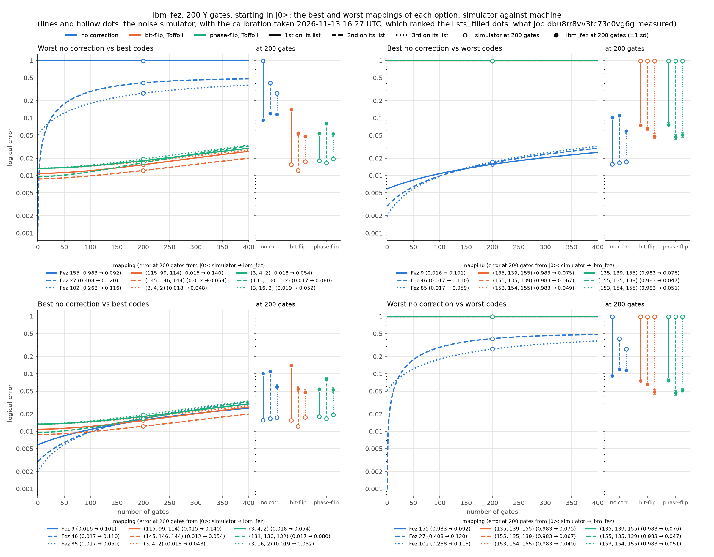
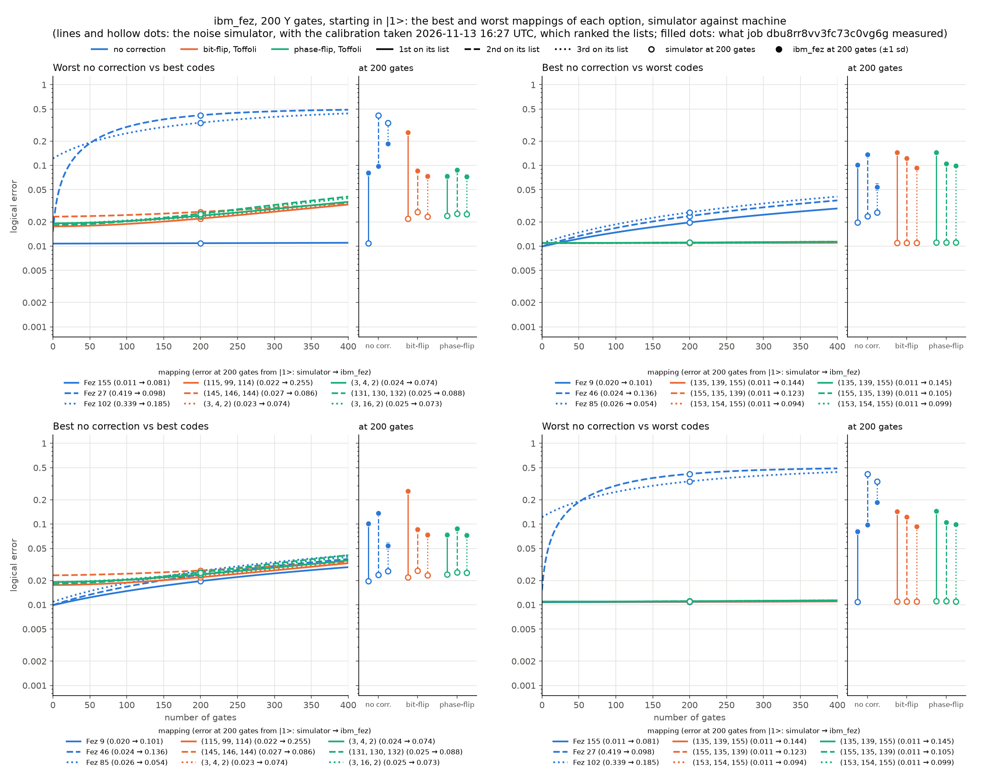

# The match-ups on the real ibm_fez: 200 Y gates

mapping_pay_off.py's plots for job `dbu8rr8vv3fc73c0vg6g` (mapping_hardware.py, 2000 shots per circuit), with the best and worst mappings that ran on ibm_fez. Each match-up pairs the top 3 of each list, as in mapping_pay_off.py. The full results, with the match-up tables, are in [mapping_hardware_ibm_fez_y_200.md](mapping_hardware_ibm_fez_y_200.md).

- **Lines:** the error the noise simulator predicts at every number of gates from 0 to 400, with the noise of the calibration file the job was ranked from (taken 2026-11-13 16:27 UTC).
- **Right of each panel, at 200 gates:** each mapping's predicted error (hollow dot) and the error ibm_fez measured (filled dot, with one standard deviation of shot noise), joined by a line in the mapping's line style. Each option's dots go 1st, 2nd, 3rd on its list from left to right.
- ibm_fez ran at 200 gates only, so it gives one point per mapping, not a line, and there are no pay-off points from it.

