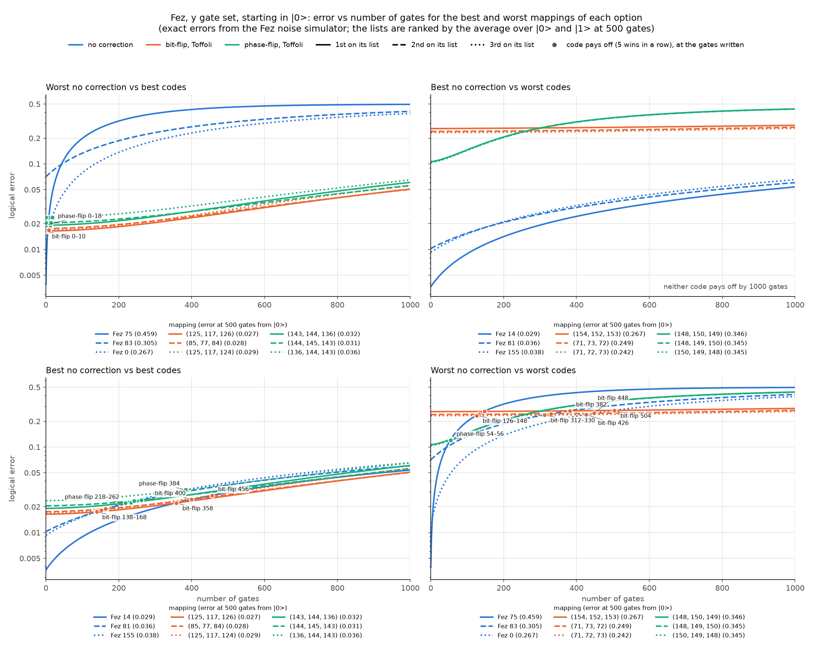
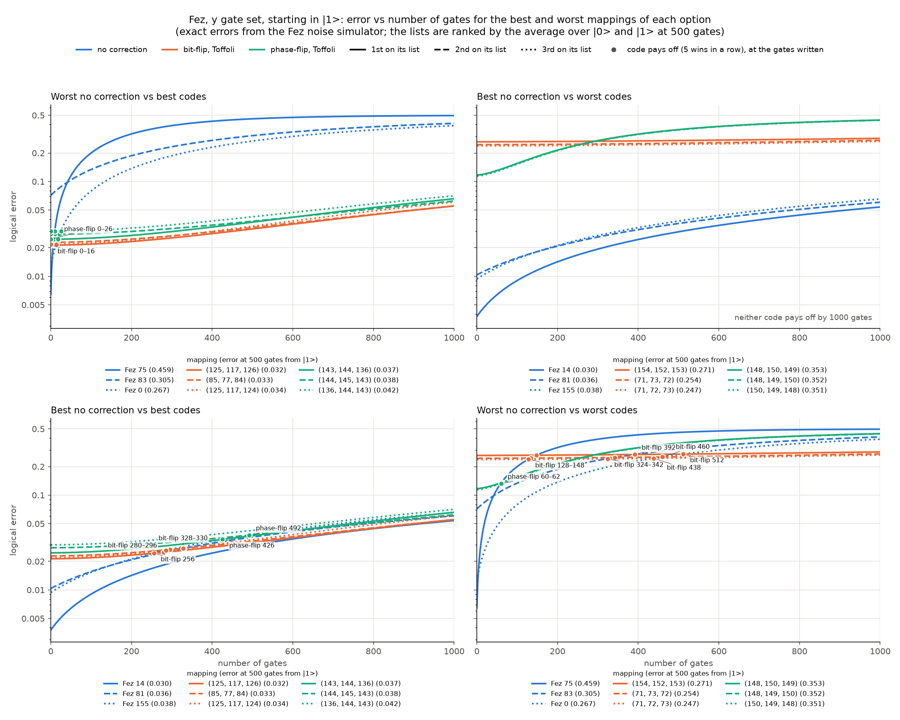

# Best and worst mappings on Fez, and when the codes pay off: y gate set

From `csvs/mapping_sweep_y_500.csv` (mapping_sweep.py): the exact error at 500 gates on the Fez noise simulator, averaged over starting in |0> and |1>. The codes' placements are q_0, q_1, q_2 on 3 connected Fez qubits.

## The 10 best mappings of each option

| rank | no correction |  error | bit-flip        |  error | phase-flip      |  error |
|-----:|---------------|-------:|-----------------|-------:|-----------------|-------:|
|    1 | Fez 14        | 0.0295 | (125, 117, 126) | 0.0293 | (143, 144, 136) | 0.0347 |
|    2 | Fez 81        | 0.0361 | (85, 77, 84)    | 0.0302 | (144, 145, 143) | 0.0347 |
|    3 | Fez 155       | 0.0383 | (125, 117, 124) | 0.0314 | (136, 144, 143) | 0.0394 |
|    4 | Fez 35        | 0.0396 | (125, 124, 126) | 0.0319 | (145, 144, 143) | 0.0399 |
|    5 | Fez 46        | 0.0403 | (91, 92, 98)    | 0.0319 | (144, 143, 136) | 0.0408 |
|    6 | Fez 100       | 0.0442 | (85, 77, 86)    | 0.0320 | (131, 132, 138) | 0.0408 |
|    7 | Fez 133       | 0.0452 | (45, 46, 37)    | 0.0324 | (143, 145, 144) | 0.0409 |
|    8 | Fez 143       | 0.0464 | (125, 126, 124) | 0.0328 | (143, 136, 144) | 0.0414 |
|    9 | Fez 125       | 0.0466 | (91, 98, 90)    | 0.0332 | (37, 45, 25)    | 0.0427 |
|   10 | Fez 134       | 0.0471 | (45, 37, 46)    | 0.0333 | (144, 143, 145) | 0.0429 |

## The 10 worst mappings of each option

| rank | no correction |  error | bit-flip        |  error | phase-flip      |  error |
|-----:|---------------|-------:|-----------------|-------:|-----------------|-------:|
|    1 | Fez 75        | 0.4590 | (154, 152, 153) | 0.2691 | (148, 150, 149) | 0.3498 |
|    2 | Fez 83        | 0.3048 | (71, 73, 72)    | 0.2516 | (148, 149, 150) | 0.3482 |
|    3 | Fez 0         | 0.2671 | (71, 72, 73)    | 0.2442 | (150, 149, 148) | 0.3479 |
|    4 | Fez 148       | 0.2496 | (153, 155, 154) | 0.2433 | (150, 148, 149) | 0.3448 |
|    5 | Fez 16        | 0.2454 | (73, 72, 71)    | 0.2387 | (149, 150, 148) | 0.3381 |
|    6 | Fez 31        | 0.2173 | (73, 71, 72)    | 0.2312 | (149, 148, 150) | 0.3348 |
|    7 | Fez 67        | 0.2039 | (72, 70, 71)    | 0.2244 | (151, 150, 149) | 0.2992 |
|    8 | Fez 147       | 0.1920 | (152, 153, 154) | 0.2205 | (149, 151, 150) | 0.2964 |
|    9 | Fez 87        | 0.1910 | (153, 152, 154) | 0.2159 | (149, 150, 151) | 0.2917 |
|   10 | Fez 57        | 0.1829 | (154, 153, 152) | 0.2136 | (151, 149, 150) | 0.2916 |

## When the codes pay off

Each match-up pairs every one of the 3 code placements with every one of the 3 no-correction qubits, taken from the top of the lists above. A code pays off at the first number of gates where its error starts being lower than no correction's 5 times in a row (as in pay_off.py), counting from 0 in steps of 2 up to 1000. Here no correction runs on its own qubit, not on the one the code is measured on. Errors are exact, and each starting state is counted on its own: each cell is the pay-off point starting in |0> / |1> (>1000: it hadn't paid off by 1000 gates). The number in brackets is each mapping's error at 500 gates, averaged over starting in |0> and |1> (what the lists are ranked by).

One plot per starting state, with a marker where each code pays off:

### Worst no correction vs best codes

| code       | best placements          | vs Fez 75 (0.4590) | vs Fez 83 (0.3048) | vs Fez 0 (0.2671) |
|------------|--------------------------|-------------------:|-------------------:|------------------:|
| bit-flip   | (125, 117, 126) (0.0293) |              6 / 8 |              0 / 0 |            8 / 14 |
| bit-flip   | (85, 77, 84) (0.0302)    |              6 / 8 |              0 / 0 |           10 / 16 |
| bit-flip   | (125, 117, 124) (0.0314) |              6 / 8 |              0 / 0 |            8 / 14 |
| phase-flip | (143, 144, 136) (0.0347) |              8 / 8 |              0 / 0 |           12 / 18 |
| phase-flip | (144, 145, 143) (0.0347) |             8 / 10 |              0 / 0 |           14 / 22 |
| phase-flip | (136, 144, 143) (0.0394) |            10 / 10 |              0 / 0 |           18 / 26 |

- bit-flip: pays off in 9 of 9 pairs from |0> (0 to 10 gates) and 9 of 9 pairs from |1> (0 to 16 gates)
- phase-flip: pays off in 9 of 9 pairs from |0> (0 to 18 gates) and 9 of 9 pairs from |1> (0 to 26 gates)

### Best no correction vs worst codes

| code       | worst placements         | vs Fez 14 (0.0295) | vs Fez 81 (0.0361) | vs Fez 155 (0.0383) |
|------------|--------------------------|-------------------:|-------------------:|--------------------:|
| bit-flip   | (154, 152, 153) (0.2691) |      >1000 / >1000 |      >1000 / >1000 |       >1000 / >1000 |
| bit-flip   | (71, 73, 72) (0.2516)    |      >1000 / >1000 |      >1000 / >1000 |       >1000 / >1000 |
| bit-flip   | (71, 72, 73) (0.2442)    |      >1000 / >1000 |      >1000 / >1000 |       >1000 / >1000 |
| phase-flip | (148, 150, 149) (0.3498) |      >1000 / >1000 |      >1000 / >1000 |       >1000 / >1000 |
| phase-flip | (148, 149, 150) (0.3482) |      >1000 / >1000 |      >1000 / >1000 |       >1000 / >1000 |
| phase-flip | (150, 149, 148) (0.3479) |      >1000 / >1000 |      >1000 / >1000 |       >1000 / >1000 |

- bit-flip: pays off in 0 of 9 pairs from |0> and 0 of 9 pairs from |1>
- phase-flip: pays off in 0 of 9 pairs from |0> and 0 of 9 pairs from |1>

### Best no correction vs best codes

| code       | best placements          | vs Fez 14 (0.0295) | vs Fez 81 (0.0361) | vs Fez 155 (0.0383) |
|------------|--------------------------|-------------------:|-------------------:|--------------------:|
| bit-flip   | (125, 117, 126) (0.0293) |        358 / >1000 |          138 / 280 |           140 / 256 |
| bit-flip   | (85, 77, 84) (0.0302)    |        400 / >1000 |          168 / 330 |           164 / 296 |
| bit-flip   | (125, 117, 124) (0.0314) |        456 / >1000 |          152 / 328 |           152 / 286 |
| phase-flip | (143, 144, 136) (0.0347) |      >1000 / >1000 |        234 / >1000 |           218 / 426 |
| phase-flip | (144, 145, 143) (0.0347) |      >1000 / >1000 |        262 / >1000 |           242 / 492 |
| phase-flip | (136, 144, 143) (0.0394) |      >1000 / >1000 |      >1000 / >1000 |         384 / >1000 |

- bit-flip: pays off in 9 of 9 pairs from |0> (138 to 456 gates) and 6 of 9 pairs from |1> (256 to 330 gates)
- phase-flip: pays off in 5 of 9 pairs from |0> (218 to 384 gates) and 2 of 9 pairs from |1> (426 to 492 gates)

### Worst no correction vs worst codes

| code       | worst placements         | vs Fez 75 (0.4590) | vs Fez 83 (0.3048) | vs Fez 0 (0.2671) |
|------------|--------------------------|-------------------:|-------------------:|------------------:|
| bit-flip   | (154, 152, 153) (0.2691) |          148 / 148 |          382 / 392 |         504 / 512 |
| bit-flip   | (71, 73, 72) (0.2516)    |          132 / 134 |          330 / 342 |         448 / 460 |
| bit-flip   | (71, 72, 73) (0.2442)    |          126 / 128 |          312 / 324 |         426 / 438 |
| phase-flip | (148, 150, 149) (0.3498) |            56 / 62 |      >1000 / >1000 |     >1000 / >1000 |
| phase-flip | (148, 149, 150) (0.3482) |            56 / 62 |      >1000 / >1000 |     >1000 / >1000 |
| phase-flip | (150, 149, 148) (0.3479) |            54 / 60 |      >1000 / >1000 |     >1000 / >1000 |

- bit-flip: pays off in 9 of 9 pairs from |0> (126 to 504 gates) and 9 of 9 pairs from |1> (128 to 512 gates)
- phase-flip: pays off in 3 of 9 pairs from |0> (54 to 56 gates) and 3 of 9 pairs from |1> (60 to 62 gates)
