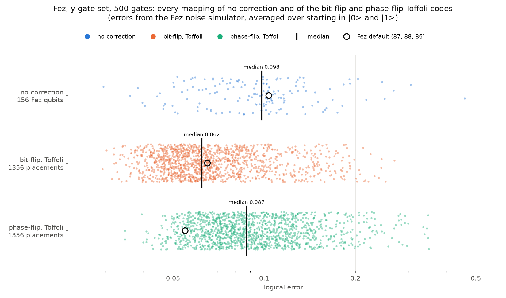

# Qubit mapping sweep on Fez: y gate set, 500 gates

From the Fez noise simulator, as the exact chance of reading the wrong answer (no shots). Each error is averaged over starting in |0> and |1>.

- **no correction** on each of Fez's 156 qubits
- **the bit-flip and phase-flip Toffoli codes** on 1356 placements: every way of putting q_0, q_1 and q_2 on 3 connected Fez qubits (226 lines x 6 choices of roles)

## Each option over all its mappings

| option              | mappings |   best | median |  worst | best on         | worst on        | Fez default                                        |
|---------------------|---------:|-------:|-------:|-------:|-----------------|-----------------|----------------------------------------------------|
| no correction       |      156 | 0.0295 | 0.0980 | 0.4590 | Fez 14          | Fez 75          | 0.1036 on Fez 86, lower than 37% of mappings       |
| bit-flip, Toffoli   |     1356 | 0.0293 | 0.0623 | 0.2691 | (125, 117, 126) | (154, 152, 153) | 0.0650 on (87, 88, 86), lower than 45% of mappings |
| phase-flip, Toffoli |     1356 | 0.0347 | 0.0874 | 0.3498 | (143, 144, 136) | (148, 150, 149) | 0.0549 on (87, 88, 86), lower than 92% of mappings |

Median error over all mappings, by starting state:

| starting state | no correction | bit-flip | phase-flip |
|----------------|--------------:|---------:|-----------:|
| 0              |        0.0979 |   0.0592 |     0.0845 |
| 1              |        0.0981 |   0.0652 |     0.0903 |

## Head to head on the same placement

No correction is the run on the Fez qubit each code is measured on, as in compare_fez.py, so all three are read out by the same qubit.

| option              | lowest of the three on | beats no correction on |
|---------------------|-----------------------:|-----------------------:|
| no correction       | 303 of 1356 placements |                      - |
| bit-flip, Toffoli   | 990 of 1356 placements |           1052 of 1356 |
| phase-flip, Toffoli |  63 of 1356 placements |            740 of 1356 |

- Bit-flip is lower than phase-flip on 1288 of 1356 placements. Phase-flip minus bit-flip: median +0.0176, middle half +0.0071 to +0.0393
- Typical change from switching the option on one placement (the median gap between its best and worst option): 0.0467
- Change from moving each option from its median mapping to its best: no correction 0.0685, bit-flip 0.0330, phase-flip 0.0528
- Do the options put the placements in the same order? Rank correlation no correction vs bit-flip 0.32, no correction vs phase-flip 0.09, bit-flip vs phase-flip 0.67 (1 = the same order, 0 = unrelated)

## Which matters more: the mapping or the option

The spread of the errors of all three options on every placement (their summed squared distance from their average), split into 4 parts that add up to it. The second column leaves out the placements that need SWAPs to encode.

| part of the spread                   | all placements | q_0 in the middle only |
|--------------------------------------|---------------:|-----------------------:|
| which 3 Fez qubits                   |          41.9% |                  39.8% |
| which qubit plays which role         |          12.2% |                  12.0% |
| which option                         |           7.8% |                  10.7% |
| the option gap changing by placement |          38.1% |                  37.5% |
| the mapping (the first two together) |          54.1% |                  51.7% |

**The mapping matters more here:** the mapping accounts for 54% of the spread and the option for 8%.
